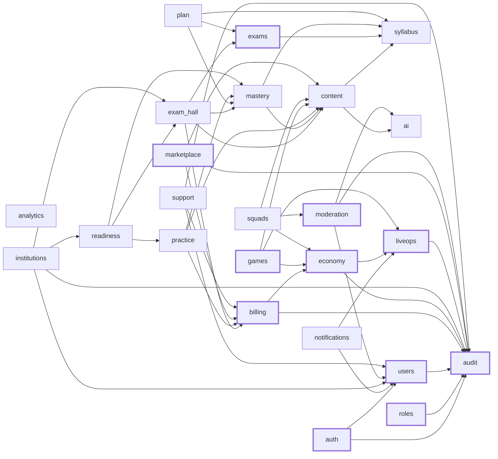

# Backend modules

> GENERATED by `tools/gen-module-docs.mjs` from `packages/domain/src/modules/*/module.json`. Do not edit.

Arrows point from a module to the modules it may import (through their `index.ts`). Anything else fails `pnpm boundaries`.

Thick border = founder approval on every change (money, personal data, game fairness, security).

| Module | Week | Coverage | Founder approval | Owns | May depend on |
|---|---|---|---|---|---|
| [`audit`](../../packages/domain/src/modules/audit/MODULE.md) | 1 | 90% | yes | AuditLog | — |
| [`auth`](../../packages/domain/src/modules/auth/MODULE.md) | 1 | 90% | yes | User credential link, OtpCode, Session, RefreshToken (family), Device, TwoFactor | users, audit |
| [`content`](../../packages/domain/src/modules/content/MODULE.md) | 1 | 70% | — | Lesson, Question, QuestionVersion, Source, Correction, QuestionReport, ContentPack | syllabus, ai |
| [`exams`](../../packages/domain/src/modules/exams/MODULE.md) | 1 | 70% | yes | ExamFamily, Exam, ExamStage, Paper, PaperSection, MarkingScheme, ExamAttemptCycle, EligibilityRule, UserExamChoice, ExamWatchChange, ExamAlert, Vacancy, Cutoff | syllabus |
| [`roles`](../../packages/domain/src/modules/roles/MODULE.md) | 1 | 90% | yes | RoleAssignment | audit |
| [`syllabus`](../../packages/domain/src/modules/syllabus/MODULE.md) | 1 | 70% | — | Syllabus, Subject, Topic, TopicExamTag, TextbookRef, Glossary | — |
| [`users`](../../packages/domain/src/modules/users/MODULE.md) | 1 | 70% | yes | User, Consent, PrivacySettings | audit |
| [`exam-hall`](../../packages/domain/src/modules/exam-hall/MODULE.md) | 2 | 90% | — | Mock, MockAttempt, MockAnswer, MockAllowanceUse, MockRank | content, mastery, billing, exams |
| [`mastery`](../../packages/domain/src/modules/mastery/MODULE.md) | 2 | 90% | — | UserTopicState, TopicCheck, RingEvent, UserRank | syllabus, content |
| [`notifications`](../../packages/domain/src/modules/notifications/MODULE.md) | 2 | 70% | — | PushToken, AlertPreference, SendLog | users, liveops |
| [`plan`](../../packages/domain/src/modules/plan/MODULE.md) | 2 | 70% | — | Plan, PlanExam, PlanItem, StudyLog | syllabus, mastery, exams |
| [`practice`](../../packages/domain/src/modules/practice/MODULE.md) | 2 | 70% | — | PracticeSession, PracticeAnswer, PracticeDayCounter, MistakeTally, ConceptDrill | content, mastery, billing |
| [`readiness`](../../packages/domain/src/modules/readiness/MODULE.md) | 2 | 70% | — | ReadinessSnapshot, SundayReport | mastery, practice, exam-hall |
| [`ai`](../../packages/domain/src/modules/ai/MODULE.md) | 3 | 70% | — | AiTask, AiModelRoute, AiUsage | — |
| [`billing`](../../packages/domain/src/modules/billing/MODULE.md) | 3 | 90% | yes | Product, Purchase, Entitlement, Refund, Gift, RazorpayOrder | economy, audit |
| [`economy`](../../packages/domain/src/modules/economy/MODULE.md) | 3 | 90% | yes | SparksLedger, PointsLedger, TrophyLedger, Cosmetic, UserCosmetic, CheckInTrack, Season, SeasonPassProgress | audit, liveops |
| [`games`](../../packages/domain/src/modules/games/MODULE.md) | 3 | 90% | yes | GameRoom, GameResult, OddsConfig (versioned), League, Trophy | content, economy, liveops |
| [`squads`](../../packages/domain/src/modules/squads/MODULE.md) | 3 | 70% | — | Squad, SquadMember, SquadBattle, BattleAttempt, HelpRequest, ChatMessage, SquadGoal | content, economy, moderation |
| [`analytics`](../../packages/domain/src/modules/analytics/MODULE.md) | 4 | 70% | — | AnalyticsEvent (partitioned) | — |
| [`institutions`](../../packages/domain/src/modules/institutions/MODULE.md) | 4 | 70% | — | Institution, Seat, Batch | users, exam-hall, readiness, audit |
| [`liveops`](../../packages/domain/src/modules/liveops/MODULE.md) | 4 | 70% | yes | LiveEvent, FeatureFlag, EmergencySwitch | audit |
| [`marketplace`](../../packages/domain/src/modules/marketplace/MODULE.md) | 4 | 90% | yes | Creator, CreatorItem, Payout, Publisher, Book, BookOrder | content, billing, audit |
| [`moderation`](../../packages/domain/src/modules/moderation/MODULE.md) | 4 | 70% | yes | ModerationCase, Sanction, Appeal | users, ai, audit |
| [`support`](../../packages/domain/src/modules/support/MODULE.md) | 4 | 70% | — | Ticket, TicketMessage | users, billing, audit |
